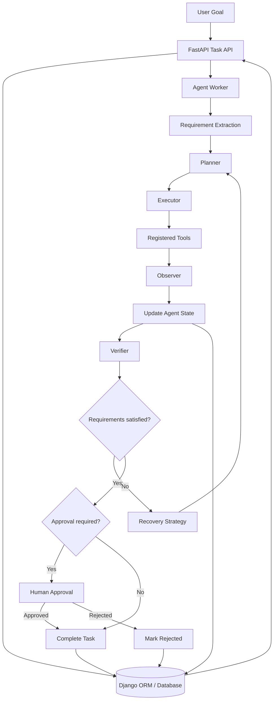

# NutriCoach Agentic Worker

**An agentic AI system for nutrition-product analysis, constraint-aware recommendations, tool execution, recovery, verification, and human-in-the-loop approval.**

[](https://www.python.org/)
[](https://fastapi.tiangolo.com/)
[](https://www.djangoproject.com/)
[](#testing)

## Overview

NutriCoach Agentic Worker is an agent-oriented system that turns natural-language nutrition-product requests into structured, verifiable tasks.

Rather than relying on a single model response, the system uses a worker architecture to interpret requirements, plan actions, execute tools, observe their results, recover from failures, verify outcomes, and request human approval when required.

For example, a user can request:

> Find a protein bar under ₹150 with at least 20 g of protein and less than 5 g of added sugar.

The worker searches available products, evaluates them against the constraints, records its execution state, and presents a recommendation for approval before completing the task.

The project focuses on **reliable agent execution and observable task state**, not simply generating conversational answers.

## Key Features

- **Natural-language requirements:** Extracts product preferences and constraints from a user goal.
- **Planning and execution:** Converts a goal into actionable steps and executes them through registered tools.
- **Tool-based analysis:** Supports product search, ingredient analysis, and OCR-related workflows.
- **Constraint-aware comparison:** Compares product attributes against requirements.
- **Observation and state tracking:** Records tool actions, observations, current step, errors, and retry counts.
- **Failure recovery:** Supports retrying execution, continuing, relaxing constraints where appropriate, or stopping.
- **Verification:** Checks whether the recommendation satisfies the task requirements.
- **Human-in-the-loop approval:** Supports explicit approval or rejection before final completion.
- **Persistent task management:** Stores task state using Django's ORM.
- **REST API:** Exposes endpoints to create tasks, inspect their status, and approve or reject recommendations.
- **Execution observability:** Exposes timestamps, errors, recovery information, and execution duration through task responses.
- **Automated testing:** Includes tests for agent components, API behavior, lifecycle transitions, failures, and observability.

## Architecture



### Core components

| Component | Responsibility |
|---|---|
| `planner.py` | Creates a sequence of steps for the requested goal. |
| `requirement_extractor.py` | Extracts structured requirements from natural-language input. |
| `executor.py` | Coordinates the execution of planned steps through tools. |
| `observer.py` | Captures execution observations and results. |
| `recovery.py` | Determines how to respond to recoverable execution failures. |
| `verifier.py` | Validates whether the task outcome meets its requirements. |
| `comparator.py` | Compares candidate products against task constraints. |
| `approval.py` | Handles human approval and rejection decisions. |
| `state.py` | Represents the agent's current task and execution state. |
| `worker.py` | Orchestrates the agent workflow. |
| `task_service.py` | Coordinates task execution and persistence. |
| `tools/` | Contains the registered tools used by the worker. |
| `api/routes.py` | Implements task creation, retrieval, approval, and rejection endpoints. |
| `agent_tasks/models.py` | Defines the persistent task model. |

## Task Lifecycle

A task progresses through the following stages:

1. **Submission:** Receive a natural-language goal through the API.
2. **Initialization:** Create a persistent task record.
3. **Requirement extraction:** Convert the goal into structured constraints.
4. **Planning:** Determine the steps needed to satisfy the goal.
5. **Execution:** Run the relevant tools and collect their outputs.
6. **Observation:** Record actions, outputs, and errors.
7. **Recovery:** Retry or adjust the execution strategy when appropriate.
8. **Verification:** Evaluate the result against the task constraints.
9. **Approval:** Wait for an explicit human decision when approval is required.
10. **Completion:** Persist the final outcome and expose it through the API.

A task awaiting approval is not treated as a completed task. This distinction allows the system to preserve the pending decision and resume the appropriate workflow after approval or rejection.

## Example

Consider the request:

`Find a protein bar under ₹150 with at least 20g protein and less than 5g added sugar.`

The mock product dataset contains two candidates:

| Product | Price | Protein | Added sugar |
|---|---:|---:|---:|
| Choco Protein Bar | ₹120 | 20 g | 12 g |
| Peanut Protein Bar | ₹135 | 21 g | 3 g |

The Choco Protein Bar fails the added-sugar constraint. The Peanut Protein Bar satisfies all three numerical constraints and can be selected as the candidate recommendation.

The worker can then verify the candidate and wait for human approval before final completion.

*The example uses mock product data and illustrates constraint evaluation; it does not establish a real-world nutrition or health claim.*

## API Reference

The API uses the `/api/v1` prefix.

| Method | Endpoint | Purpose |
|---|---|---|
| `POST` | `/api/v1/tasks` | Create and schedule a task. |
| `GET` | `/api/v1/tasks/{task_id}` | Retrieve task state and execution details. |
| `POST` | `/api/v1/tasks/{task_id}/approve` | Approve a pending task. |
| `POST` | `/api/v1/tasks/{task_id}/reject` | Reject a pending task. |

### Create a task

Request:

```bash
curl -X POST "http://127.0.0.1:8000/api/v1/tasks" \
  -H "Content-Type: application/json" \
  -d "{\"goal\":\"Find a protein bar under 150 rupees with at least 20g protein and less than 5g added sugar\"}"
```

The response includes a task identifier and initial task state. Use the returned `task_id` to inspect execution progress.

### Retrieve task status

```bash
curl "http://127.0.0.1:8000/api/v1/tasks/YOUR_TASK_ID"
```

The task response exposes fields such as:

- `status`
- `constraints`
- `plan`
- `current_step`
- `observations`
- `actions`
- `errors`
- `retry_count`
- `recovery_action`
- `approval_required`
- `approval_status`
- `verification_result`
- `final_result`
- `started_at`
- `completed_at`
- `execution_duration_seconds`

### Approve or reject

```bash
curl -X POST "http://127.0.0.1:8000/api/v1/tasks/YOUR_TASK_ID/approve"
```

Or:

```bash
curl -X POST "http://127.0.0.1:8000/api/v1/tasks/YOUR_TASK_ID/reject"
```

Approval and rejection are valid only when the task requires approval and is awaiting a decision. Invalid transitions return an API error.

## Project Structure

```text
NutriCoach-Agentic-Worker/
├── backend/
│   ├── agent/
│   │   ├── agent.py
│   │   ├── approval.py
│   │   ├── comparator.py
│   │   ├── executor.py
│   │   ├── observer.py
│   │   ├── planner.py
│   │   ├── recovery.py
│   │   ├── requirement_extractor.py
│   │   ├── requirements.py
│   │   ├── state.py
│   │   ├── task_service.py
│   │   ├── verifier.py
│   │   └── worker.py
│   ├── agent_tasks/
│   │   ├── models.py
│   │   ├── admin.py
│   │   ├── apps.py
│   │   └── migrations/
│   ├── api/
│   │   ├── main.py
│   │   ├── routes.py
│   │   └── schemas.py
│   ├── model/
│   │   └── rag_service.py
│   └── tools/
│       ├── ingredient_tool.py
│       ├── ocr_tool.py
│       ├── product_tool.py
│       └── registry.py
├── mock_environment/
│   └── products.json
├── tests/
│   └── api/
│       └── test_tasks.py
├── pytest.ini
├── requirements.txt
└── README.md
```

The tree highlights the main modules; additional settings, migrations, and test files may be present.

## Installation and Setup

### Prerequisites

- Python installed locally
- Git
- A virtual environment
- The dependencies specified by the project

### 1. Clone the repository

```bash
git clone https://github.com/Anwesha-TU/NutriCoach-Agentic-Worker.git
cd NutriCoach-Agentic-Worker
```

### 2. Create and activate a virtual environment

On Windows:

```powershell
python -m venv .venv
.venv\Scripts\Activate.ps1
```

On macOS or Linux:

```bash
python -m venv .venv
source .venv/bin/activate
```

### 3. Install dependencies

```bash
python -m pip install --upgrade pip
pip install -r requirements.txt
```

Ensure the dependency file includes the packages needed by the current agent, API, Django, and test implementations.

### 4. Configure environment variables

Create a local `.env` file or configure the environment variables required by your local settings and integrations.

Do not commit API keys, passwords, or other secrets. If an integration requires a model API key, provide it through the configured environment variable.

### 5. Apply database migrations

From the repository root:

```bash
python backend/manage.py migrate
```

### 6. Start the API

From the repository root:

```bash
uvicorn api.main:app --app-dir backend --reload
```

The development server should be available at `http://127.0.0.1:8000`.

If the application uses a different local settings configuration, follow the environment setup expected by `backend/api/main.py`.

## Testing

Run the test suite from the repository root:

```bash
pytest
```

The latest reported test run completed with **97 passed and 4 warnings in 34.32 seconds**.

The tests cover core execution behavior and API workflows, including task creation and retrieval, approval and rejection rules, lifecycle timestamps, failure handling, and observability response fields.

Test counts can change as the project evolves. Run the suite locally to confirm the current result.

## Engineering Design Principles

- **Explicit state:** Represent task progress and outcomes as structured state.
- **Tool-based execution:** Keep external capabilities separate from orchestration logic.
- **Verifiable outcomes:** Evaluate candidate results against explicit requirements.
- **Controlled recovery:** Handle failures through defined recovery strategies rather than unbounded retries.
- **Human oversight:** Require explicit approval when the workflow calls for it.
- **Observability:** Persist enough execution information to investigate task behavior.
- **Separation of concerns:** Keep planning, execution, verification, persistence, and API handling in distinct modules.

## Current Scope and Future Improvements

Potential next steps include:

- Add GitHub Actions CI for automated tests.
- Add structured logging and request correlation IDs.
- Improve recovery and verification metrics.
- Add stronger configuration validation and environment documentation.
- Add integration tests for concurrent task execution.
- Containerize the API and database configuration.
- Build a dashboard for inspecting task plans, actions, failures, and approval status.

## Disclaimer

NutriCoach is an informational software project. Product data and ingredient analysis depend on the underlying data sources and model outputs. Recommendations should not be treated as medical advice or as a substitute for professional dietary guidance.

## Author

Developed by **Anwesha Chakraborty**.

Repository: [NutriCoach-Agentic-Worker](https://github.com/Anwesha-TU/NutriCoach-Agentic-Worker)
