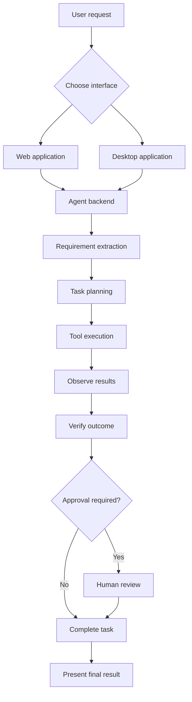

# TaskPilot — Agentic AI Employee Runtime

**From company goals to verified work.**

TaskPilot is a proof of concept exploring how AI agents can move beyond generating answers to executing multi-step tasks through tools, observing results, verifying outcomes, and requesting human approval when needed.

The project combines an agent execution backend with two interfaces: a browser-based web application and a PyQt5 desktop application.

Rather than claiming to automate every business workflow, TaskPilot demonstrates agentic execution through supported product-recommendation and invoice-processing workflows.

## Overview

Company work is spread across applications, documents, websites, and internal systems. Completing a request often requires understanding the intended outcome, identifying the required steps, using tools, evaluating results, handling failures, and confirming that the work was completed correctly.

TaskPilot explores the engineering behind that execution loop:

**Goal → Understand → Plan → Execute → Observe → Verify → Complete**

Human approval is supported at configured decision points.

## Applications

### Web application

A browser-based interface for interacting with the agent through a local development server.

The web interface is intended to provide a convenient way to submit tasks, inspect execution results, and interact with supported workflows.

### Desktop application

A PyQt5 desktop interface for running and reviewing agent tasks locally.

The desktop version provides an alternative to the browser interface while using the project's Python-based application components.

### Agent backend

The backend contains the task worker, planner, requirement extractor, executor, and tools used by supported workflows.

The extent to which the two interfaces share task state and execution history depends on their actual backend integration and persistence configuration.

## Core Capabilities

- **Requirement extraction:** Convert natural-language requests into structured constraints.
- **Task planning:** Create execution plans for supported task types.
- **Tool orchestration:** Dispatch operations through modular tool interfaces.
- **Product search and comparison:** Evaluate available products against user-defined requirements.
- **Execution observations:** Collect and process tool outputs.
- **Verification:** Check results before reporting completion in supported workflows.
- **Human-in-the-loop approval:** Pause configured workflows for a human decision.
- **Invoice processing:** Extract invoice fields and line items and flag inconsistencies for review.
- **Multiple interfaces:** Access the project through a local web application or a PyQt5 desktop application.

## Architecture



This is a conceptual overview of the architecture. The actual workflow and approval behavior depend on the selected task and implemented execution path.

## Example Workflows

### Product recommendation

A user requests a product using constraints such as category, budget, minimum protein, and maximum added sugar.

The agent extracts requirements, searches the available product data, compares candidates, evaluates the recommendation, and requests human approval when required.

### Invoice processing

The agent processes an invoice, extracts structured fields and line items, and identifies inconsistencies that require review.

Uncertain extracted values should remain distinguishable from verified information; discrepancies should not be silently corrected.

## Technology Stack

- **Language:** Python
- **Backend API:** FastAPI
- **Desktop interface:** PyQt5
- **Web interface:** React.js, with the frontend development tooling configured in the repository
- **Agent architecture:** Planner, worker, requirement extractor, executor, and tool registry
- **LLM integration:** Gemini
- **Document processing:** OCR and invoice extraction
- **Testing:** pytest

## Repository Structure

```text
TaskPilot/
├── backend/
│   ├── agent/
│   ├── api/
│   └── tools/
├── tests/
├── frontend.py
├── README.md
└── [web frontend directory]
```

The web frontend directory is shown as a placeholder. Replace it with the actual directory name from the repository and expand the tree to match the current codebase.

## Getting Started

### Prerequisites

- Python environment compatible with the project's dependencies
- Conda or another supported Python environment manager
- Node.js and npm for the web frontend
- Git
- Required API credentials for external model services

### 1. Clone the repository

```bash
git clone https://github.com/YOUR_USERNAME/taskpilot.git
cd taskpilot
```

Replace `YOUR_USERNAME` with your GitHub username.

### 2. Set up the Python environment

Activate the existing environment:

```powershell
conda activate deepsort
```

Install the project's Python dependencies using the dependency file maintained in the repository. If a root-level `requirements.txt` exists:

```powershell
python -m pip install -r requirements.txt
```

Configure required API credentials through the environment variables expected by the application. Never commit secrets.

### 3. Start the backend

From the repository root:

```powershell
uvicorn api.main:app --reload --app-dir backend
```

The local FastAPI documentation is typically available at:

http://127.0.0.1:8000/docs

### 4. Start the web application

Open another terminal and navigate to the directory containing the web frontend's `package.json`.

For a Vite-based React application, the commands are typically:

```powershell
npm install
npm run dev
```

Open the local URL printed by the development server. A Vite application commonly uses port 5173, but use the actual URL shown in your terminal.

### 5. Start the desktop application

Open a separate terminal from the repository root:

```powershell
conda activate deepsort
python frontend.py
```

The web application and desktop application are separate interfaces. Start the services required by the particular interface you want to test.

## Testing

Run the automated Python test suite from the repository root:

```powershell
python -m pytest tests -q
```

The most recently reported result was **97 passed, 0 failed**. Rerun the suite after code or dependency changes to confirm the current status.

Automated backend tests do not replace end-to-end checks of the web interface, desktop interface, and their integration with the backend.

## Engineering Principles

- **Outcome-oriented execution:** Focus on completing tasks rather than only generating responses.
- **Modular architecture:** Separate planning, execution, tools, and interfaces.
- **Observable behavior:** Use execution outputs and task state to assess what happened.
- **Verification:** Evaluate results before reporting completion.
- **Human oversight:** Preserve approval checkpoints where configured.
- **Incremental extensibility:** Make it possible to introduce additional tools and workflows without rewriting the entire worker.

## Current Scope and Limitations

TaskPilot is an experimental task-execution prototype, not a production-ready autonomous company operator.

Its demonstrated workflows are limited to the task types, tools, and data sources implemented in the repository. General-purpose browser automation, arbitrary desktop control, persistent organization-wide memory, distributed task queues, and reliable execution across arbitrary enterprise systems should not be assumed to be implemented.

Recovery, verification, approval, and persistence behavior must be evaluated for each workflow. The web and desktop interfaces should also be tested independently.

## Future Engineering Directions

- Improve failure classification, recovery, and replanning.
- Add reusable connectors for APIs, files, browsers, and desktop applications.
- Introduce persistent, organization-scoped memory with access controls.
- Strengthen permissions, approval policies, and audit trails.
- Add structured execution traces and evidence-backed completion.
- Evaluate reliability through repeatable end-to-end tests.
- Explore background execution, retries, scheduling, and task queues.
- Improve packaging and deployment for reproducible use.

## License

No license required

**TaskPilot — Plan. Execute. Verify.**
